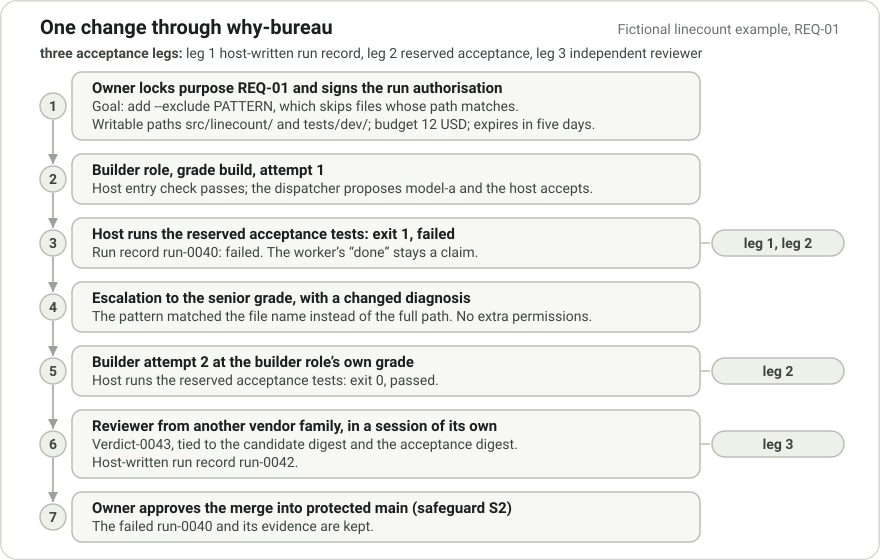
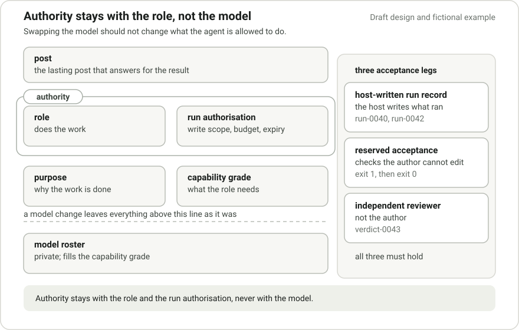

# why-bureau

A method, charter and specification for people and AI agents to explain each piece of work: why, how, where, what and by whom.

[](LICENSE) [](https://github.com/sourav-patra/why-bureau/releases)

Version 0.1.3. Draft specification; no reference implementation yet.



*[Fictional example](examples/linecount/README.md): run-0040 fails acceptance; run-0042 passes with verdict-0043. The failed attempt remains recorded.*

*Left out: reserved acceptance paths, escalation counts and the roster. All names, models and numbers are placeholders.*

## Why

Engineers who run coding agents, alone or in a team, want agent work they can trust, audit and hand over.

Coding agents now write, test and ship real changes.

Text can steer them. They keep working when nobody is looking. They pass data to outside services. The model underneath can change without notice.

Teams that hand them work need to know, after the fact, who authorised a change, what it was meant to achieve, which checks judged it, and what actually ran.

Chat transcripts and an agent's own report of success cannot answer those questions.

Evidence you can run: `python schemas/check.py` validates the fictional example's records of failed and passing acceptance.

The check verifies document structure. Runtime enforcement and record authenticity remain unverified.

## Features

- Authority stays with the role and the run authorisation, the authenticated permission for a run. Changing the model leaves permissions unchanged.
- Acceptance has three independent legs: the host writes the run record, a reviewer who is not the author judges the change, and tests the author cannot edit must pass.
- Safeguards S1 to S5 and tenets 1 to 14 in [METHOD.md](METHOD.md); who decides what, and when work stops, in [CHARTER.md](CHARTER.md).
- JSON Schemas describe the allowed structure of roles, run records and escalation paths. Their check script needs only the Python standard library.
- One [worked example](examples/linecount/README.md) follows a single change from purpose to merge.

The proposed host is the protected system that runs agents and checks their work. Adapters, a host and reference code are planned.

Adopting the texts enforces no runtime controls. [Status and limits](#status-and-limits) lists what remains unverified.

## Quick start

Use Git and Python 3.

1. Get the repository and check its entry files:

   ```
   git clone https://github.com/sourav-patra/why-bureau.git
   cd why-bureau
   python -c "from pathlib import Path; assert all(Path(p).is_file() for p in ('README.md', 'METHOD.md', 'CHARTER.md')); print('entry files present')"
   ```

   The last line reads `entry files present`.

2. Check the schemas and the worked example:

   ```
   python schemas/check.py
   ```

   The last line reads `13 expected valid, 17 expected invalid, 0 unexpected`.

3. Read [examples/linecount/README.md](examples/linecount/README.md), then check its two run records:

   ```
   python schemas/check.py schemas/run-record.schema.json examples/linecount/run-0040.run-record.json
   python schemas/check.py schemas/run-record.schema.json examples/linecount/run-0042.run-record.json
   ```

   Each command prints `valid` and exits with status 0.

Details of the check script are in [schemas/README.md](schemas/README.md).

## Docs

| File | What it holds |
|---|---|
| [METHOD.md](METHOD.md) | The method: safeguards S1 to S5, tenets 1 to 14, and practice guidance. Adopted by decision 0001. |
| [CHARTER.md](CHARTER.md) | The charter: who decides what, allowed change kinds, approvals, escalation and stops, and the security annex. Adopted by decision 0002. |
| [MODEL.md](MODEL.md) | The operating model: elements, layers, roles, grades, failure states, the escalation path, memory. |
| [RECORDS.md](RECORDS.md) | What a run record holds, how evidence is kept and deleted, and how reviews are bound to the work. |
| [POLICY.md](POLICY.md) | Policy rules: role requests, record kinds, the arbiter, roster switches, budgets. |
| [ADAPTERS.md](ADAPTERS.md) | Adapters, hosts, entry checks, qualification, rendering and the security model. |
| [ROADMAP.md](ROADMAP.md) | Prototype steps, their acceptance items, and open questions. |
| [schemas/](schemas/) | JSON Schemas for the role, the run record and the escalation path, with examples and a check script. |
| [decisions/](decisions/) | Decision records that adopt METHOD.md and CHARTER.md, each pinned by its SHA-256. |
| [examples/](examples/) | One worked example on a small made-up command-line tool. |
| [REFERENCES.md](REFERENCES.md) | Public sources, and which sources back each rule. |

Start with METHOD.md for the reasoning, then CHARTER.md for authority. The specification is MODEL.md, RECORDS.md, POLICY.md, ADAPTERS.md and ROADMAP.md together.

### How it works



*Design only: the model fills a capability grade and holds no authority. A model change leaves the role, purpose and grade as they were.*

*Left out: who keeps the roster and how a switch is approved. The run identifiers and exit codes come from the fictional example.*

why-bureau keeps five things separate: post, role, purpose, capability grade and private model roster.

A post is an accountable identity that persists over many sessions and fills one role on one project.

The role says what work is done; the post answers for it. Purpose records why the work is done.

The capability grade states what the role needs. The private model roster selects the model that fills that grade.

The host, not the worker, writes the authenticated run record that says what ran.

Checks the author cannot edit, the reserved acceptance, must pass.

A reviewer who is not the author judges the change.

### Labels

Lines labelled **Required** bind this repository.

A team adopting the method is held only to safeguards S1 to S5; for that team everything else is advice to try and measure.

Every control in the method, the charter and the specification carries a label.

- **Required**: a requirement. In the specification, a Required control names the safeguard, tenet or charter section it repeats.
- **Suggested**: something to trial and evaluate. Only a later revision can turn it into a rule, and no Suggested control is worded as one.
- No label: a definition, a fact, an explanation or an open question.

Adopting these texts does not enforce any of their controls, Required or Suggested. Nothing in this repository enforces them yet.

## Status and limits

- The repository holds design documents, JSON Schemas with a check script, decision records and one example. Adapters, a host and reference code are planned and do not exist yet.

External project status below is reported and not verified here.

- A separate project, [tiller-book](https://github.com/sourav-patra/tiller-book) (0.1.0-alpha), provides local checks that a plan was signed and, for build changes, that a change stayed inside its allowed paths and left a record naming its commit.

Changes with no files and plan-only changes skip the path and record checks, and the checks count only when someone runs them.

Reviewer identity, required checks on main and lesson filing are not enforced yet. This repository does not depend on tiller-book.

- Not verified: whether any source was signed, adoption in live use, qualification of any runtime, and any present claim about external products.

## Licence

- **Required.** This repository is licensed under the Apache License 2.0. See [LICENSE](LICENSE) and [NOTICE](NOTICE).
